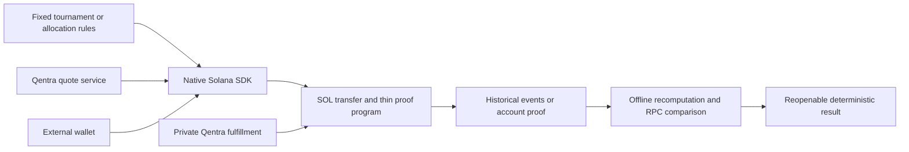

# Architecture and trust boundaries

The inspectable interface contains native request/result APIs, generated instruction/account/event codecs, the IDL and deterministic helpers. Qentra's service issues persisted prices, checks payment receipts and schedules checked reveals. Service execution and unrevealed source values remain outside the package. The program records commitments and checks reveal/output binding; it does not implement service bookkeeping or custom fee escrow.

Qentra is the public source identity. Developers verify commitments, fixed inputs, reveal consistency, output and mapping. These checks establish record integrity; they do not independently certify source physics. The program is live on mainnet at `CcoAe9c5yenzozkSqdiJAmaCeoZTiSSV5urBUnC1oa8d`, with upgrade authority retained. Explicit RPC/quote configuration and service readiness remain integration requirements.

The browser adapter remains a historical cryptographic source mode with its own schema and tests, under a separate subpath. Native Solana proof records do not inherit browser generation claims.
